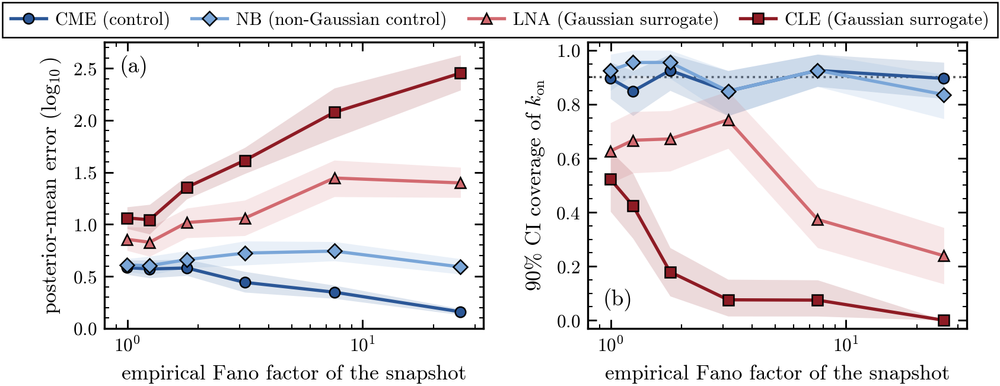
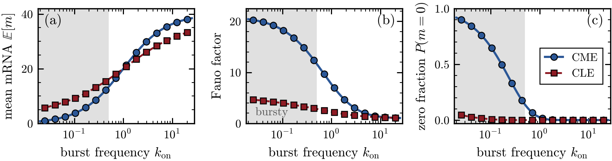
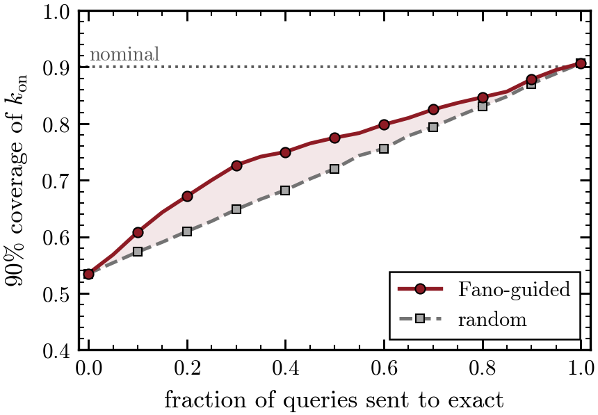

<div align="center">

# Predicting When Cheap Simulators Break<br>Neural Inference of Bursty Gene Expression

**Rafael Velásquez** · **Pablo Arbeláez**<br>
Universidad de los Andes, Colombia

[](https://www.latinxinai.org/)
[](paper/cheap_simulators_lxai2026.pdf)
[](https://www.python.org/)
[](https://github.com/sbi-dev/sbi)
[](LICENSE)

</div>

<p align="center">
  
</p>

<p align="center"><sub><b>Main result.</b> Neural posterior estimators trained on four simulators and evaluated on
exact data. The Gaussian surrogates (reds) lose calibration where expression turns bursty, while a
count-valued surrogate carrying the same moments (light blue) tracks the exact control (dark blue).</sub></p>

---

## TL;DR

Amortized simulation-based inference (SBI) is often trained on a **cheap approximate simulator**
instead of the exact model that generated the data. In single-cell gene expression, the usual
shortcut replaces the exact chemical master equation (CME) with Gaussian approximations such as the
chemical Langevin equation (CLE) or the linear noise approximation (LNA). We use the two-state
(telegraph) model, whose exact answer is known in closed form, to show **when** this shortcut breaks
neural inference, **why** it breaks, and how a number read directly off each snapshot, its
**Fano factor**, flags the queries at risk before running inference.

## Key findings

| | Finding | Evidence |
|---|---|---|
| 🔍 | **The CLE is wrong in one direction.** In the bursty regime it overestimates the mean, suppresses the Fano factor and erases zero-inflation. | Zero fraction 0.90 (exact) against 0.04 (CLE) |
| 📉 | **Both Gaussian surrogates miscalibrate NPE.** The CLE fails everywhere; the LNA holds until the empirical Fano reaches about 4.5 and then collapses. | 90% coverage of k_on: CLE 0.21, LNA 0.55, control 0.89 |
| 🧪 | **The distributional family, not cheapness, drives the failure.** A negative binomial with the *same* moments as the LNA is calibrated, and matching moments alone does not rescue the Gaussians. | NB 0.91 against LNA 0.55 |
| 🧭 | **The Fano factor routes queries.** Sending the highest-Fano queries to the exact estimator beats random routing at every budget. | At half the budget: 0.78 against 0.72 |
| 📈 | **More data makes it worse.** The CLE's calibration falls as snapshots grow, the signature of misspecification rather than noise. | CLE coverage 0.40 at 100 cells, 0.13 at 2000 |

<table>
  <tr>
    <td width="62%"></td>
    <td width="38%"></td>
  </tr>
  <tr>
    <td><sub><b>The CLE misspecifies the model only where expression is bursty</b> (shaded): it inflates the mean, flattens the Fano factor and loses the zeros.</sub></td>
    <td><sub><b>Fano-guided routing</b> recovers calibration with fewer queries sent to the exact model than random routing.</sub></td>
  </tr>
</table>

## The setup in one table

| Training simulator | Role | What it keeps | What it misses |
|---|---|---|---|
| **CME** (Poisson-Beta) | exact control | everything | |
| **NB** (negative binomial) | non-Gaussian control | exact mean and Fano, counts, zeros | exact shape |
| **LNA** (Gaussian, clipped at zero) | cheap surrogate | exact mean and variance (before clipping) | zero-inflation, skew |
| **CLE** (Euler-Maruyama) | cheap surrogate | dynamics in the continuum limit | discreteness of the gene and the counts |

Each estimator is a masked autoregressive flow trained with [`sbi`](https://github.com/sbi-dev/sbi)
on 8,000 simulations of 500-cell snapshots, reduced to six summary statistics, and every estimator is
evaluated on the same held-out set of exact snapshots.

## Repository structure

```
cheap-simulators-bursty-sbi/
├── telegraph.py         # telegraph model: exact CME sampler, CLE, LNA, NB, closed-form moments, summaries
├── sbi_experiment.py    # prior and batched simulation of snapshots
├── run_experiment.py    # Table 1, Figures 2-3, Appendix A (saves results_main.npz)
├── run_budget.py        # Figure 4, Fano-guided vs random routing (saves budget_curves.npz)
├── run_ablation.py      # moments-only feature ablation
├── run_seeds.py         # robustness across five seeds
├── run_ncells.py        # robustness to the snapshot size
├── paper_figures.py     # every figure in the paper style; computes Figure 1
├── reproduce.sh         # runs everything in order
├── assets/              # figures shown in this README
└── paper/               # camera-ready PDF
```

## Installation

```bash
git clone https://github.com/Rafther0112/cheap-simulators-bursty-sbi.git
cd cheap-simulators-bursty-sbi
conda create -n cheap-sbi python=3.10 -y
conda activate cheap-sbi
pip install -r requirements.txt
```

A GPU is not required.

## Reproducing the paper

Everything at once:

```bash
./reproduce.sh
```

Or item by item:

| Paper item | Command |
|---|---|
| Table 1, Figures 2 and 3, Appendix A | `python run_experiment.py --n_sims 8000 --n_cells 500 --n_test 400 --seed 0` |
| Figure 4 | `python run_budget.py --n_sims 8000 --n_cells 500 --n_test 600` |
| Figure 1 (and a redraw of every figure) | `python paper_figures.py` |
| Moments-only ablation | `python run_ablation.py --n_sims 8000 --n_cells 500 --n_test 400` |
| Seed robustness | `python run_seeds.py --n_sims 8000 --n_cells 500 --n_test 400 --seeds 0 1 2 3 4` |
| Snapshot-size robustness | `python run_ncells.py --n_sims 8000 --n_cells 100 200 500 2000 --sims cme cle` |

Training sets are cached in `cache/` after the first run. The CLE training set is the slowest
step (about 6 to 8 minutes for 8,000 simulations); each estimator then trains in a few minutes.
`paper_figures.py` redraws every figure from the saved `.npz` files without retraining, as vector
PDFs and 300 dpi PNGs.

> **Note.** Training uses fixed seeds, but normalizing-flow training is not bit-for-bit
> deterministic across hardware and library versions, so re-runs can differ from the reported
> numbers in the second decimal.

## Citation

```bibtex
@inproceedings{velasquez2026predicting,
  title     = {Predicting When Cheap Simulators Break Neural Inference of Bursty Gene Expression},
  author    = {Vel{\'a}squez, Rafael and Arbel{\'a}ez, Pablo},
  booktitle = {LatinX in AI Workshop at the 40th Conference on Neural Information Processing Systems (NeurIPS 2026)},
  year      = {2026},
  note      = {Non-archival}
}
```

## License

The code is released under the [MIT License](LICENSE). The manuscript in `paper/` is shared for
academic use.
